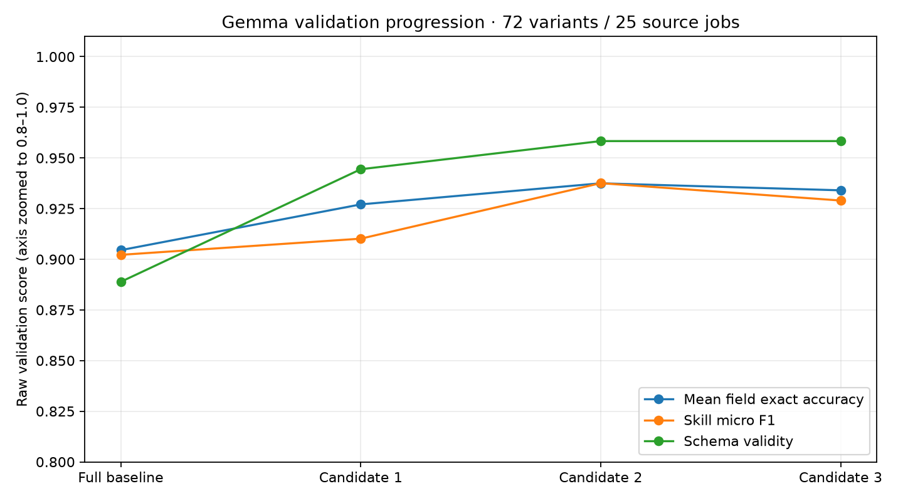

# Gemma — kết quả cuối sau cải tiến

Adapter được chọn bằng validation: `adapters/gemma-jobs/20261017T105728Z`.
Dừng: candidate budget exhausted. Đạt toàn bộ mục tiêu: False.

| Metric thô | Validation (72 mẫu / 25 tin) | Test (82 mẫu / 28 tin) |
|---|---:|---:|
| JSON hợp lệ | 100.00% | 100.00% |
| Schema hợp lệ | 95.83% | 95.12% |
| Accuracy trung bình 8 trường | 93.75% | 93.90% |
| Skill micro F1 | 93.76% | 91.85% |

| Accuracy từng trường | Validation | Test |
|---|---:|---:|
| role | 94.44% | 97.56% |
| location | 100.00% | 100.00% |
| experience_years | 98.61% | 98.78% |
| skills | 56.94% | 54.88% |
| salary_min | 100.00% | 100.00% |
| salary_max | 100.00% | 100.00% |
| currency | 100.00% | 100.00% |
| salary_period | 100.00% | 100.00% |



Test chỉ chấm cho adapter đã chọn; không đổi model hoặc train tiếp theo lỗi test.
Điểm chọn tổng hợp chỉ dùng validation, không dùng điểm tổng hợp test để xếp hạng.
Đây là nhãn silver; biến thể không phải tin độc lập. Kết quả phản ánh trích xuất
phiếu tin theo schema, không phải MAE dự đoán lương của Ridge/Random Forest.
Không cam kết điểm đẹp trên dữ liệu mới hoặc sai số cực tiểu toàn cục.

Lỗi cụ thể, slice theo biến thể và MAE số cùng đơn vị: error_analysis.json
trong thư mục evaluation tương ứng. Dự đoán thô và checksum đều được giữ.
Muốn cải thiện sau đợt này: thêm tin độc lập, duyệt nhãn gold và chuẩn bị
holdout mới trước khi mở vòng nghiên cứu tiếp theo; không dùng test đã mở làm validation.

Suy luận (không train):

```bash
GEMMA_ADAPTER=adapters/gemma-jobs/20261017T105728Z make gemma-infer-adapter
```
