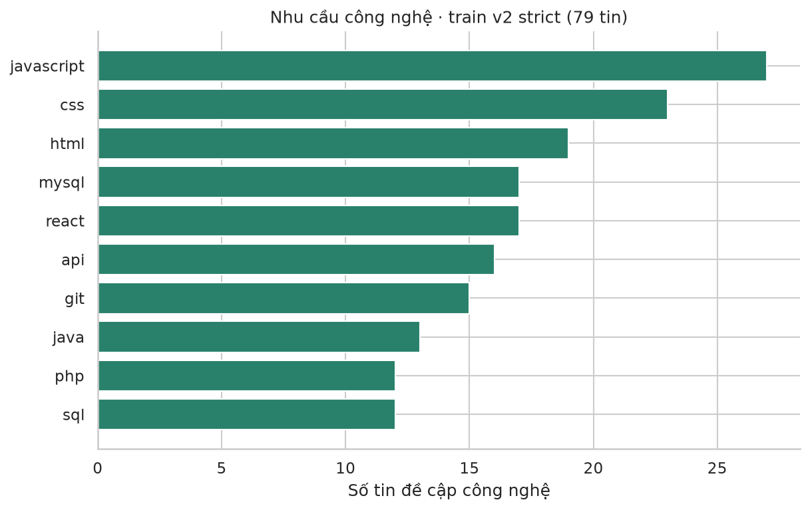
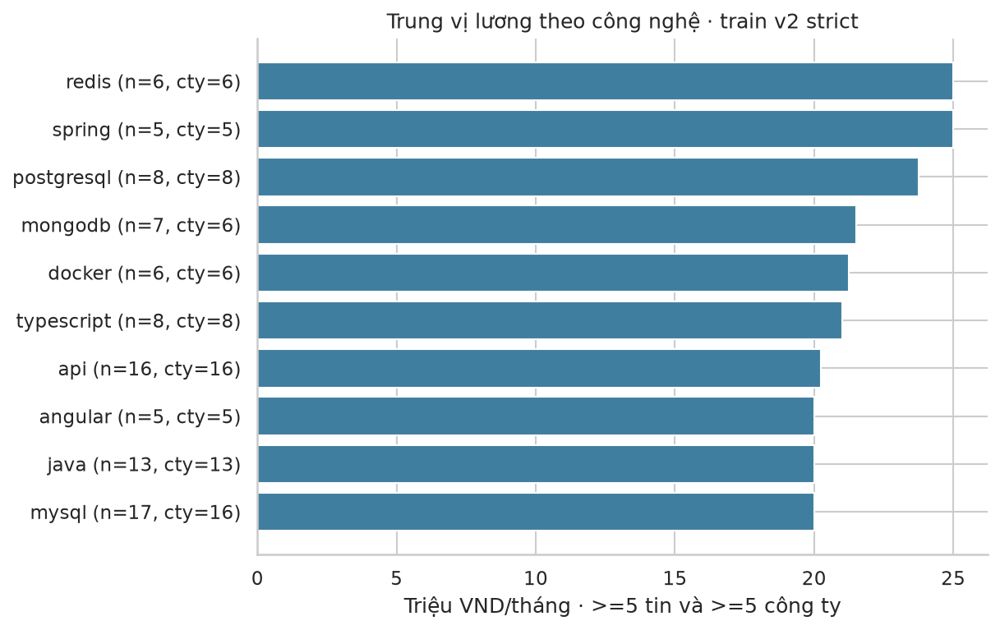
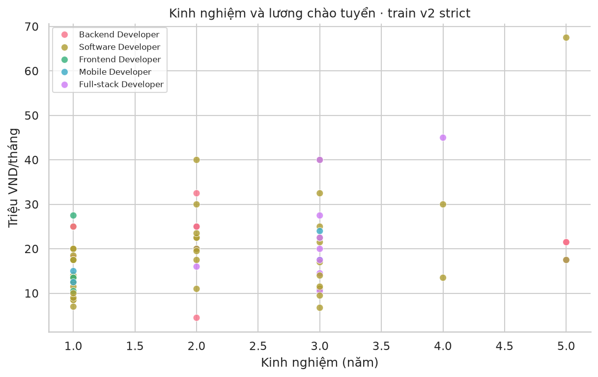
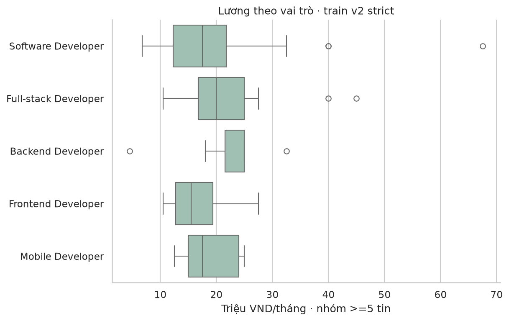
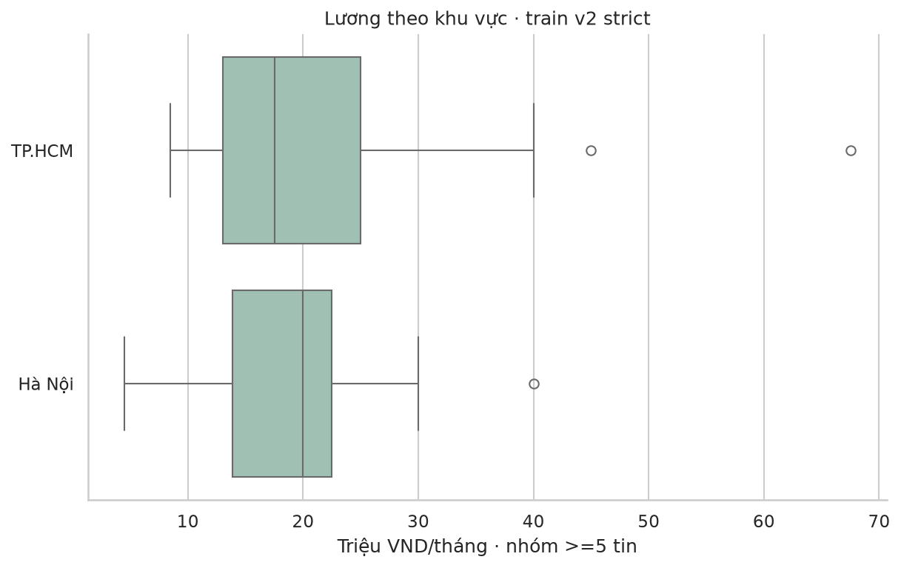
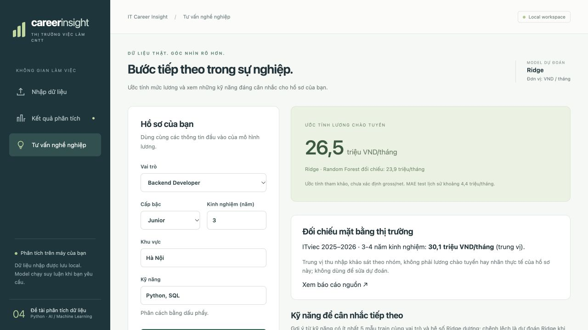

# Phân tích xu hướng thị trường việc làm CNTT và dự đoán mức lương lập trình viên

**Bản nội dung kỹ thuật để đưa vào mẫu giảng viên — chưa phải báo cáo cá nhân hoàn chỉnh.**

STT, họ tên, MSSV, lớp, giảng viên và mẫu trình bày: chờ thông tin. Không tự tạo thông tin sinh viên. Các kết quả dưới đây dựa trên artifact đã lưu; thử nghiệm không đạt được ghi rõ và không tự đưa vào ứng dụng.

## 1. Bài toán và phạm vi

Ứng dụng giúp người dùng đọc bảng tin tuyển dụng, xem nhu cầu kỹ năng, so sánh lương theo kinh nghiệm/vai trò/khu vực và ước tính mức lương chào tuyển cho một hồ sơ. Công cụ tư vấn đề xuất kỹ năng có liên hệ với mức lương cao hơn trong dữ liệu train. Phạm vi chính là tám vai trò lập trình, không đại diện toàn bộ nghề CNTT.

Mục tiêu dự đoán là midpoint của khoảng lương chào tuyển VND/tháng khi đủ điều kiện. Đây không phải thu nhập thực nhận của cá nhân. Thu nhập khảo sát có thể khác lương chào tuyển về thưởng, gross/net và cơ cấu người tham gia.

## 2. Dữ liệu và xử lý

Dự án lưu các nguồn CSV do người dùng cung cấp, nguồn tuyển dụng Việt Nam và TiniX Vietnam Job Description. TiniX có 606.878 bản ghi gốc, được lưu revision/checksum và điều kiện sử dụng theo dataset card. Dữ liệu lớn được tải theo manifest, không đưa toàn bộ vào Git. Một CSV do người dùng cung cấp chưa có link nguồn gốc nên provenance được ghi là chưa xác minh. Nguồn và đường tải ở `docs/DATA_SOURCES.md`.

Luồng làm sạch gồm chuẩn Unicode/chuỗi, loại bản ghi thiếu điều kiện, bóc tách tên công nghệ và alias, chuẩn vai trò/khu vực, kiểm tra tiền tệ/kỳ lương, khoảng lương đảo ngược, lương censored và kinh nghiệm mâu thuẫn. VND/năm chỉ được chia 12 khi kỳ năm có bằng chứng; không tự đổi ngoại tệ. Dữ liệu thiếu không được coi là số 0. Không suy kinh nghiệm từ chức danh Senior/Junior.

Mô hình lương v2 dùng strict train 79 mẫu có kỳ tháng rõ và weak train 1.078 mẫu thiếu kỳ, được giả định tháng với trọng số 0,3; validation 25 và test 30 có bằng chứng kỳ tháng. Nhãn vẫn là silver. Split theo công ty và loại các công ty từng xuất hiện trong holdout cũ; preprocessing chỉ fit trên train. Vai trò, kinh nghiệm, cấp bậc, khu vực và kỹ năng là feature; không dùng lương nguồn, công ty hay ID làm feature dự đoán.

Các lần salary v3/v3.1 chỉ dùng nhãn kỳ tháng rõ đã được thử và lưu kết quả, nhưng không thay v2 vì holdout độc lập quá nhỏ và mức khớp tham chiếu thị trường chưa tốt hơn. Không lựa chọn chỉ theo một con số đẹp.

## 3. Phân tích và trực quan hóa

Ứng dụng dùng Pandas cho xử lý bảng, Matplotlib và Seaborn cho biểu đồ PNG. Các biểu đồ gồm top ngôn ngữ/công nghệ theo số tin, trung vị lương theo kỹ năng với số mẫu, kinh nghiệm–lương và so sánh theo vai trò/khu vực. Lương được cung cấp và lương dự đoán được phân biệt; không trình bày đầu ra model như dữ liệu thu nhập quan sát.

Dòng trùng hoàn toàn vẫn có kết quả theo dòng nhưng không đếm lại trong thống kê/metric. Không đủ dữ liệu thì hiển thị thiếu dữ liệu thay vì tạo số liệu. Không có ngày đăng hợp lệ thì không tuyên bố xu hướng theo thời gian. Kỹ năng ngoài danh mục hiển thị vẫn được giữ trong bảng kết quả; danh mục có thể chưa đầy đủ.

Bộ biểu đồ dưới được tạo từ **79 tin strict train v2, 69 nhóm công ty**, không dùng 1.078 nhãn yếu hoặc ví dụ validation/test để tính thống kê. Nhãn strict ở đây chỉ có nghĩa kỳ tháng rõ, vẫn là silver, không phải gold do người kiểm chứng. Notebook tái lập: `notebooks/04_salary_v2_eda.ipynb`; CSV và checksum tại `outputs/eda/salary_v2_strict_train_042e3aa1a886/`. Biểu đồ cũ ở notebook 01 thuộc v1, không gán thành v2.

### 3.1. Nhu cầu và lương theo công nghệ

| Công nghệ có nhu cầu cao trong mẫu | Số tin | Số nhóm công ty |
|---|---:|---:|
| JavaScript | 27 | 24 |
| CSS | 23 | 20 |
| HTML | 19 | 16 |
| MySQL | 17 | 16 |
| React | 17 | 17 |

Chỉ xếp hạng trung vị lương của công nghệ có ít nhất 5 tin và 5 nhóm công ty.
Redis và Spring cùng 25 triệu/tháng (lần lượt 6 và 5 tin); PostgreSQL 23,75 triệu
(8 tin), MongoDB 21,5 triệu (7 tin), Docker 21,25 triệu (6 tin). Đây là lương của
tin có đề cập công nghệ, chịu ảnh hưởng vai trò/kinh nghiệm và các kỹ năng đi kèm.
Không thể kết luận riêng công nghệ đó tạo ra chênh lệch thu nhập. Mỗi công nghệ
được đếm tối đa một lần/tin; một tin có thể nằm trong nhiều nhóm kỹ năng.

### 3.2. Kinh nghiệm, vai trò và khu vực

Tương quan Pearson kinh nghiệm–lương trong 79 mẫu là **r = 0,385**, cho thấy liên
hệ tuyến tính dương ở mức vừa trong mẫu này. Đây không phải R² của mô hình và
không chứng minh thêm một năm kinh nghiệm sẽ tăng một lượng lương cố định.

Tập strict train có Software Developer 48 tin, Full-stack 11, Backend 9,
Frontend 6 và Mobile 5. Không có strict train cho Data/ML/Embedded nên không
suy diễn mức lương quan sát của ba vai trò này từ biểu đồ. Biểu đồ khu vực chỉ
trình bày nhóm có ít nhất 5 tin: TP.HCM 35 và Hà Nội 32; các địa chỉ/nhóm nhỏ
vẫn được giữ trong CSV, không tự nhập vào một thành phố khác.

### 3.3. Kỹ năng liên hệ với dự đoán lương

Phân tích Ridge dùng snapshot **1.157 tin train gồm cả nhãn yếu**, khác phạm vi
79 tin của thống kê mô tả trên. Các hệ số kỹ năng dương lớn trong model đã fit:
PyTorch khoảng +9,12 triệu (15 tin), Rust +7,05 triệu (10), Rails +5,44 triệu (13),
ASP.NET Core +4,75 triệu (23), Docker +4,75 triệu (208). Skill feature là binary;
hệ số mô tả thay đổi dự đoán khi thêm cờ kỹ năng và giữ các feature khác cố định.
Mẫu ít, nhãn yếu và kỹ năng đồng xuất hiện có thể làm hệ số thiếu ổn định. Đây
không phải mức tăng thu nhập đã kiểm chứng. App còn yêu cầu ít nhất 5 mẫu cùng
vai trò trước khi đề xuất. Bảng đầy đủ: `ridge_skill_associations_train.csv`
trong thư mục EDA v2 nói trên.

## 4. Hai mô hình dự đoán lương

Ridge là mô hình hồi quy tuyến tính có regularization, dùng làm mô hình dễ kiểm tra và ổn định hơn khi feature nhiều. Random Forest là tổ hợp cây, có thể mô tả quan hệ phi tuyến. Hai mô hình dùng cùng phạm vi nhãn và bộ chia. Có thêm median baseline để kiểm tra mô hình có tốt hơn một dự đoán đơn giản hay không.

Vòng v2 thử hai nhánh dữ liệu strict và strict+weak; mỗi nhánh có Ridge alpha 1/10/100 và Random Forest leaf 2/5/10. Tổng 12 ứng viên. Chọn bằng MAE validation, dùng RMSE phá hòa; không chọn theo test. Ridge alpha=1 strict+weak được chọn và kiểm tra trên test mới.

| Mô hình trên cùng 30 test mới | MAE (triệu VND/tháng) | RMSE (triệu) | R² | Sai số ≤5 triệu |
|---|---:|---:|---:|---:|
| RF v1 đối chiếu | 8,246 | 10,508 | -0,582 | 30,0% |
| Median baseline | 6,958 | 8,998 | -0,160 | 40,0% |
| RF v2 | 5,737 | 6,990 | 0,300 | 43,3% |
| Ridge v2 được chọn | 4,433 | 5,664 | 0,540 | 60,0% |

MAE cho biết sai số tuyệt đối trung bình; RMSE nhấn mạnh lỗi lớn; R² so mức giải thích biến thiên với baseline trung bình. Test gồm 30 tin từ 23 nhóm công ty, còn nhỏ và dùng silver labels. Không kết luận độ chính xác cho toàn thị trường. Kết quả cũ 6,656 triệu trên 28 test khác không được dùng làm mẫu số so sánh trực tiếp.

Bằng chứng đầy đủ: `outputs/metrics/salary_v2_042e3aa1a886/REPORT.md`, `test_metrics.json`, `test_predictions.csv`, `test_slices.json`, `selection.json` và `configs/application.json`.

## 5. Vai trò và fine-tune Gemma

Gemma `google/gemma-4-E4B-it` được fine-tune LoRA bằng MLX trên Apple Silicon để đọc tin và trả JSON tám trường: role, location, experience_years, skills, salary_min, salary_max, currency, salary_period. Gemma trích thông tin đã ghi trong tin; Ridge/Random Forest dự đoán lương từ hồ sơ. Hai tác vụ và metric được tách rõ.

Adapter đang dùng là `20261017T105728Z`, được chọn bằng validation trong vòng trước. Vòng reviewed v2 rà soát 214 dòng, chấp nhận 201, loại 13 tin sai phạm vi/mơ hồ. Đây là AI-reviewed silver, không phải human gold. Corpus gồm 501 train (137 tin mới +364 replay), 31 validation và 33 test theo công ty.

Run `20261018T002705Z` hoàn tất 501 bước. Validation loss giảm 0,392→0,110 nhưng ba regression guard cũ không đạt nên không đưa lên web. Audit sau đó xác nhận reference còn thiếu kỹ năng và kinh nghiệm viết bằng chữ/dấu cộng; đã có quyết định sửa có dẫn chứng riêng. Không tính thay đổi điểm do sửa nhãn là model cải thiện.

Corpus corrected v2.2.0 giữ prompt/company split, áp dụng policy nhãn sửa trước khi train. Run `20261018T051656Z` đã fine-tune đủ 501 bước, LR 2e-6 từ adapter đang dùng. New validation F1 tăng 80,58%→82,35% nhưng legacy giảm 93,76%→91,94%, không đạt nghiệm thu nên giữ parent. Chỉ thay adapter nếu validation mới/cũ và test mới đạt ngưỡng đã khóa. Test cũ không mở lại để tuning.

Metric Gemma gồm JSON validity, schema validity, exact accuracy từng trường và Skill micro F1. Loss chỉ theo dõi huấn luyện, không thay thế metric trích xuất hoặc MAE lương. Chính sách giữ checkpoint cũ và artifact riêng cho phép rollback.

## 6. Ứng dụng và tư vấn nghề nghiệp

Frontend Vue kết nối FastAPI. Người dùng nhập CSV/XLSX/JSON, kiểm tra ghép cột, chọn đọc mô tả bằng Gemma khi cần, chạy phân tích và tải CSV/Excel/JSON/PNG hoặc ZIP. Từng dòng có kết quả/lỗi/cảnh báo; artifact ghi model, adapter, checksum nguồn và lựa chọn của lần chạy. Lương Gemma trích không được lấy làm nhãn để tự chấm độ chính xác của chính luồng đó.

Phần tư vấn nhận vai trò, kinh nghiệm, khu vực và kỹ năng, trả dự đoán lương cùng kỹ năng nên xem xét học thêm. Gợi ý cần ít nhất 5 mẫu train cùng vai trò và tín hiệu Ridge dương. Đây là liên hệ thống kê và phản ứng của model, không phải bằng chứng học một kỹ năng sẽ làm tăng lương tương ứng.

Luồng browser đã thử với Backend Developer, Junior, 3 năm, Hà Nội, Python/SQL:
Ridge dự đoán khoảng 26,5 triệu/tháng, RF đối chiếu 23,9 triệu. ITviec nhóm
3–4 năm hiển thị riêng trung vị 30,1 triệu. Khi thêm Rust, kết quả cũ được xóa;
dự đoán lại khoảng 33,6 triệu cho Ridge và Rust không còn là gợi ý mới. Đây là
hồ sơ minh họa không có nhãn thu nhập thật, không dùng tính MAE. API live đã thử
tám vai trò; hồ sơ ML Engineer thử không đủ bằng chứng để gợi ý kỹ năng.
Bằng chứng JSON và ảnh browser thật tại `outputs/app_verification/career_demo/`.

Lệnh chạy app: `make app`. Lệnh này chỉ build/serve và suy luận. `make gemma-corrected-plan` kiểm tra kế hoạch, không train; `make gemma-corrected-train` train thật theo protocol đã khóa và từ chối khi hết ngân sách. Các lệnh corpus cũ được ghi riêng trong README.

## 7. Đối chiếu nguồn thu nhập thị trường

Dự án lưu panel tham chiếu ITviec 2025–2026 bằng VND/tháng và TopDev 2024–2025 bằng USD gross. Trên 13 nhóm ITviec đủ điều kiện, median absolute aggregate gap của v2 khoảng 21,1%, kém v1 khoảng 8,2%. Đây là hạn chế còn mở; không che giấu hoặc ép dự đoán khớp các median báo cáo. TopDev giữ đơn vị gốc và dùng tỷ số vai trò, không tự chuyển tỷ giá.

Báo cáo thu nhập khảo sát và lương chào tuyển khác population/target. Không đưa median nhóm thành nhãn cá nhân hoặc xem mức lệch nhóm là MAE độc lập. Bảng nguồn, trích trang và số liệu nằm ở `data/references/README.md` và `outputs/metrics/salary_v2_042e3aa1a886/external_sanity/`.

## 8. Kiểm thử, khó khăn và giới hạn

Đã có kiểm thử unit/integration cho chuẩn hóa, leakage/split, lineage/checksum, train/serve parity, contract Gemma, lựa chọn model, metric/export, API và frontend build. Bằng chứng API/browser của bản v2 đã lưu trong `outputs/research/2026-10-18/`; không coi kiểm thử phần mềm là chứng minh sai số dự đoán thấp.

Các khó khăn chính là nhãn thiếu kỳ lương/gross-net, từ khóa kỹ năng không đầy đủ, tin tuyển nhiều vai trò, số năm mâu thuẫn, source thiếu provenance, ít công ty trong holdout mới, context train Gemma 1.024 token, context web 2.048 token và thời gian chạy GPU. Cách xử lý là phân tầng chất lượng nhãn, giữ missing/null, audit câu nguồn, chia theo công ty, khóa protocol, giữ raw predictions, so model trên cùng tập và giữ bản cũ khi candidate giảm chất lượng. Worker đã có kiểm thử tái sử dụng mô tả trùng trong cùng request; GPU thật đã xác minh3 mô tả trùng dùng 1 lần sinh. Web có schema retry giới hạn, giữ raw attempts; kỹ năng dùng dự đoán từ mô tả cần literal evidence trong danh mục, raw Gemma giữ riêng.

Phần còn cần hoàn thiện gồm dữ liệu/validation mới cho một vòng model tiếp theo sau khi corrected không đạt, mở rộng danh mục kỹ năng và kiểm tra độ đúng nội dung trên dữ liệu nhập đại diện, nguồn dữ liệu/nhãn độc lập tốt hơn và đóng gói báo cáo cá nhân đúng mẫu. Không cam kết sai số bằng 0 hoặc tối ưu toàn cục.

## 9. Sản phẩm và tái lập

Repository: https://github.com/theihoz/ML/tree/publish/salary-gemma-prep . Nhánh source gọn chứa mã, notebook, split/nhãn đã version, final adapter đã nghiệm thu hoặc đánh giá và báo cáo thực nghiệm; dữ liệu/trọng số lớn tải theo manifest. `make submission-data` tạo `outputs/submission/datasets.zip`: 42 file dữ liệu/provenance và một manifest, kiểm tra SHA-256/CRC/số dòng. Gói tách serving dataset khỏi corrected trial không đạt. Nguồn và quyền sử dụng được chỉ dẫn trong `docs/DATASET_HANDOFF.md` và `docs/DATA_SOURCES.md`.

Khi trình bày: mở app, nhập bảng mẫu, kiểm tra đơn vị/ghép cột, chạy phân tích, chỉ rõ model hiện dùng và cảnh báo, xem biểu đồ, thử tư vấn và tải ZIP. Khi có nhãn lương do người dùng cung cấp, giải thích metric trên bảng nhập không phải test holdout độc lập. Kịch bản 7–10 phút ở `docs/DEMO_SCRIPT.md`, lệnh chạy ở `docs/APP_RUNBOOK.md`.

Nội dung trên đã ghi kết quả cuối của lượt corrected không đạt và dữ liệu/model đang phục vụ. Bước còn thiếu là đưa vào mẫu giảng viên và tạo một file `STT_Họ và tên_MSSV` cho mỗi thành viên sau khi được cung cấp thông tin. Không nộp bản draft này như báo cáo cá nhân đã hoàn tất.
